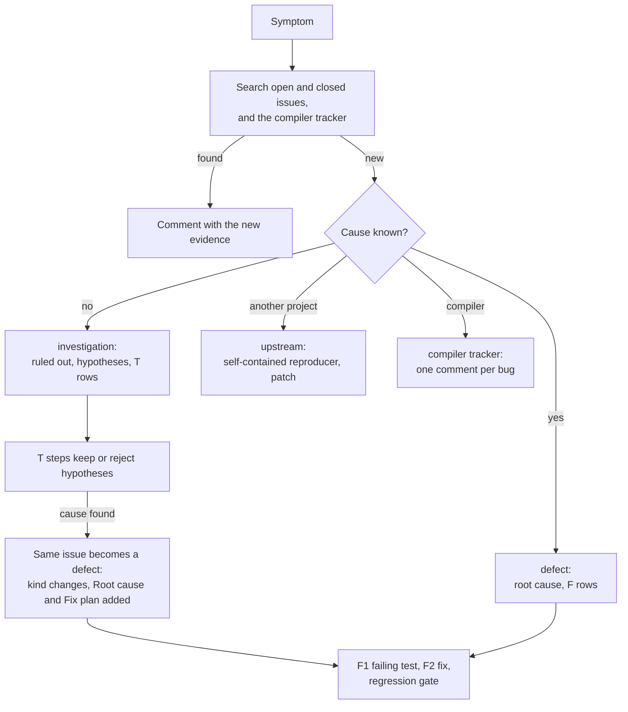

# Bug issues

A bug is filed as one GitHub issue that follows it from the first symptom to the fix. Each claim in the issue
says how well it is established, and the reproducer is the smallest one that fails. An investigation becomes a
defect in the same issue once its cause is found, so the causes already ruled out stay next to the fix.
Investigations and fixes carry the same status table as [plan issues](/claude/plan-issue), so the same script
lints and updates them, and `night commit` syncs them. Sources: `claude/.claude/skills/bug-issue/`
(`SKILL.md`, `TEMPLATE.md`, `COMPILER-BUGS.md`), with the script of the plan-issue skill.

## When to use it

"Create a GH issue for the bug, with details and a minimal reproducer", "a detailed issue with evidence and a
step by step fix (TDD)", "an issue to investigate the hangs on medooza", "track the WENO-5 slowdown", "report it
on the FoBiS repo", "is the bug saved in any GH issue?", "file the compiler bugs".

## One bug

## Kinds

| Kind | When | Sections beyond the core | Status table |
|---|---|---|---|
| `investigation` | Cause unknown: hangs, slowdowns, discrepancies | Ruled out, Hypotheses, Test plan (`T` rows) | Yes |
| `defect` | Cause known, in one of your repositories | Root cause, Fix plan (`F` rows) | Yes |
| `upstream` | A report to another project | Patch (optional) | No |

Every kind has the core: **Summary**, **Environment** (commit, exact compiler versions and flags, libraries,
machine and ranks), **Observed**, **Expected** (with its source), **Reproducer** (commands, output, frequency),
and **Evidence**. The kind is a marker, `<!-- bug-issue:kind defect -->`, and the lint checks the sections
against it.

## Evidence tiers

Every row of the Evidence table carries a tier, as in the `ai-research-verification` skill:

| Tier | Meaning |
|---|---|
| T0 | Narrative: an agent or a person says so |
| T1 | Reproduced by a script that can be rerun |
| T2 | A test in the suite, run independently |
| T3 | T2, with the spec reviewed by you |

A hypothesis is never written as a cause: *Root cause* needs T1 at least.

## Rules

| # | Rule |
|---|---|
| 1 | Search before filing (`gh issue list --state all --search`, and the compiler tracker). A match gets a comment, not a new issue |
| 2 | Reproduce before claiming: every evidence row has a tier |
| 3 | The reproducer drops every feature the bug does not need, and states its frequency. For `upstream` it runs without your code |
| 4 | Test first: **F1** is the reproducer as a test that fails on the bug; the fix step is gated by it passing and by the regression suite |
| 5 | One issue per bug: an investigation that finds its cause becomes a defect in place, keeping *Ruled out* and *Hypotheses* |
| 6 | Each `T` step's result goes in a comment with job ids and numbers, linked from its row, so no cause is tested twice |

Plan-issue rules 1–3 and 6 apply as well: the issue is the only copy, filing is not fixing, a body is never
regenerated, and bodies stay small.

## Commands

The plan-issue script, unchanged: `check`, `create`, `body`, `edit`, `status`, `set`, `comment`, `stale`,
`sync` ([Plan issues](/claude/plan-issue#commands)). `check` recognises a bug body by its
`<!-- bug-issue v1 -->` marker and then requires:

- a valid kind marker and the sections of that kind;
- at least one Evidence row with a tier T0–T3;
- a status table for `investigation` and `defect`, with at least one `F` row for a defect;
- the step fields (**Goal**, **Gate**, **Docs**, **Commit**) for every `T` and `F` row, as for plan steps.

It warns when the first `F` step's title does not name a test. `edit` keeps refusing removed rows and headings,
so turning an investigation into a defect cannot drop the hypotheses silently.

## With the night protocol

As for a plan issue: the night writes `issue`, `NN-slug.plan` (the `T` or `F` ids each step completes) and a
report draft with a `<!-- target: issue -->` first line; `night commit` posts it and marks the rows with the
commits ([details](/claude/plan-issue#with-the-night-protocol)).

## Compiler bugs

A compiler bug does not get its own issue. Each repository has one tracker, titled
`Compiler bugs: reproducers and workarounds`, and each bug is one comment on it. The tracker's body is an index
table: bug, compiler, status (`open`, `fixed in <version>`, `not a bug`), where the workaround is, and the
vendor ticket. Each comment gives:

- the toolchain, with exact versions;
- how the other compiler behaves;
- the standard rule the code conforms to;
- a self-contained reproducer with its output, and the expected output;
- the workaround, with its location and how to tell it can go;
- the vendor ticket.

The index is edited as a fixed-string change. `plan-issue edit` would refuse it, because it is neither a plan
nor a bug body.

## Why it exists

From the session logs of October and November 2026: about 8 compiler-bug issues and 15 other bug issues
(SSP(5,4) in ADAM, the FoBiS template bug, VecFor's fpm bug, the medooza hangs, the WENO-5 slowdown, the paper's
verification discrepancies, an AMD bug from a collaborator).

| What went wrong | Now |
|---|---|
| Asked whether a bug was already filed, more than once | Rule 1: search first |
| The fix plan asked for "accurate TDD" each time | F1 is the failing test; the lint warns otherwise |
| Investigations and their fixes split or restated | One issue, the kind changes in place |
| Hypotheses reported as findings | Evidence tiers; root cause needs T1 |
| The compiler tracker lived inside the plan skill, so both skills claimed "file the bug" | Its own skill; plan-issue no longer triggers on bugs |

## Things to know

- The lint flags anything in angle brackets outside code as an unfilled placeholder, except HTML tags and
  autolinks. Write a literal `<` in code spans.
- `stale` works on bug issues too: the base marker is the commit where the bug was reproduced.
- The skill has no script of its own. It uses the plan-issue script, so the two skills must stay installed
  together.
