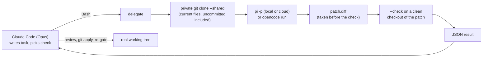

# Delegating to an executor

Claude Code with Opus stays the orchestrator. For a task that is mechanical and checkable by a command, it
hands the work to a cheaper executor: [pi](https://www.npmjs.com/package/@earendil-works/pi-coding-agent)
running a local Ollama model or a cloud model, or [opencode](https://opencode.ai) (`--harness opencode`) for
the models only it can reach. The executor works in a throwaway git clone. Opus gets back
one JSON object and judges the patch and the result of a check command it chose itself, never the executor's
own report. Sources: `claude/.claude/skills/delegate/` (`SKILL.md`, `scripts/delegate`,
`scripts/test-delegate`), and the `pi` package for the model definitions.

## Why this shape

Claude Code points one session at one endpoint, so a subagent cannot run on a different backend. A nested
headless process can, and it leaves the Opus session, its account and its subscription untouched. pi is the
default executor rather than Claude Code itself or opencode because its system prompt plus tools is about
1,600 tokens (opencode's: about 5,900), which matters on local hardware where every prompt token is prefill
time. It also talks to the OpenAI-compatible endpoint that every local server implements. opencode is the
second harness because OpenCode Zen's free models answer only inside it (see below).



## Use

Ask for it: "delegate this to the local model", "let qwen do the boilerplate". The skill tells Claude when a
task qualifies (mechanical, checkable, bounded), how to write a self-contained task, and how to review the
result. By hand:

```bash
delegate --check 'python3 -m pytest tests/test_io.py -q' --link .venv \
  "Add type annotations to every function in src/io.py. Change nothing else."
```

| Option | Default | Purpose |
|---|---|---|
| `--harness NAME` | `$DELEGATE_HARNESS`, else `pi` | `pi` or `opencode` |
| `--model P/ID` | pi: `$DELEGATE_MODEL`, else `ollama/qwen3.8-unsloth:27b-ud-q4_K_XL`; opencode: required (or `$DELEGATE_OPENCODE_MODEL`) | provider/model of the harness; opencode accepts `provider/model#variant` |
| `--check CMD` | none | Run on a clean checkout of the patch tree plus `--link` paths; `$DELEGATE_REPO` points at the real repo |
| `--timeout S` / `--check-timeout S` | 900 / 900 | Wall-clock limits; the executor's process group is killed |
| `--base REV` | `worktree` | Start from the current files (uncommitted and untracked included) or a revision |
| `--link PATH` | none | Symlink an ignored input (venv, fetched deps) into the clone, never part of the patch |
| `--tools LIST` | pi's defaults | pi tool allowlist (pi only) |
| `--thinking LEVEL` | `off` | pi thinking level (the default model was benchmarked with thinking off; pi only) |
| `--keep-alive DUR` | `30m` | How long Ollama keeps the model loaded after the run |
| `--server-wait S` | 300 | llama.cpp / ik_llama: how long to wait while `/health` reports the model loading |
| `--keep` | off | Keep the clone for inspection (`workdir` in the result) |

`executor.usage` holds, for both harnesses, `input` (uncached prompt tokens), `output`, `cache_read` and
`cost_usd` as the harness computes it from its model prices (0 for local models and free tiers). On a long run
cache reads are most of the tokens: the DeepSeek paper ingestion below was 107k input, 49k output and 2.78M
cache reads, $0.054.

Status values: `ok`, `check_failed`, `timeout`, `error`, `backend_down`, `interrupted`. Exit status is 0 only
for `ok`; 2 for setup errors found before the executor starts (not a git repository, harness missing, bad `--base`,
`--link` or `--out`); 128+N after signal N. Artifacts stay in `$XDG_CACHE_HOME/delegate/<id>/`. Apply a patch
with the `apply` field (`git -C <repo> apply <patch>`): a bare `git apply` from a subdirectory exits 0 and
skips every file outside it.

## Guarantees and limits

- **The caller's repository never moves.** Snapshots use a private `GIT_INDEX_FILE`. The base commit is a
  dangling `commit-tree --no-gpg-sign` object. The executor works in a `git clone --shared` with its remote
  removed and hooks disabled, so its commits, branches and stash stay there; a worktree would share refs with
  the caller. The clone is deleted afterwards, also on timeout and on SIGINT/SIGTERM/SIGHUP.
- **No executor process survives the run.** delegate is a child subreaper and kills every descendant after the
  executor and after the check: pi's `bash` tool detaches its children into their own process groups.
- **The patch is what the executor changed**, from plumbing (`git diff-tree --binary --full-index --no-textconv`
  …) written as raw bytes, so no diff configuration can alter it. Executor-created files show up as `A` lines
  and are part of the review. Python bytecode is suppressed (`PYTHONDONTWRITEBYTECODE=1`).
- **The check proves the patch**: it runs on a clean checkout of the patch tree plus `--link` paths, so an
  ignored file the executor left behind cannot make it pass.
- **It is not a sandbox.** pi's `bash` (opencode's `shell`) can write anywhere in `$HOME`. The clone protects
  the repository only.
- **Limits.** Submodules are empty in the clone. The starting snapshot writes blobs for untracked,
  non-ignored files into the caller's object store (unreachable, reclaimed by `git gc`).
- **A cloud model sends the files it reads to its provider.** Use one only on repositories where that is
  acceptable.

### Cloud executor: OpenCode Go

pi ≥ 1.6 ships an `opencode-go` provider (the OpenCode Go subscription), so nothing goes in `models.json`.

1. Create a key in the [OpenCode Console](https://opencode.ai/console): account menu → **Account** → **Personal
   API keys** → **Add API key**, in the workspace that has the Go plan. It starts `oc_sk_` and is shown once. The
   opencode agent's own login is OAuth (short-lived tokens in `~/.local/share/opencode/opencode.db`), not a key,
   so there is nothing to copy from it.
2. In a terminal, not through Claude Code (the key would land in the transcript): `pi`, then `/login`, choose
   OpenCode Go and paste the key. pi stores it in `~/.pi/agent/auth.json` (0600, untracked). `OPENCODE_API_KEY`
   works too.
3. `pi --list-models opencode-go` lists the plan's models; `delegate --model opencode-go/<id> …` runs one.

pi 0.80 knew an older Go endpoint (`/zen/go/v1`, without the session header Go now requires); 1.6 works, and
`delegate`'s offline and live tests pass on it. `--offline` and `-ne` do not block the cloud provider.

### opencode harness

`delegate --harness opencode --model <provider>/<id> …` runs `opencode run --standalone --format json --auto`
in the clone instead of pi: a private server for the run, permissions auto-approved (a headless run cannot
answer a prompt), and the prompt (preamble, then the task; opencode has no system-prompt option) on stdin with
no message argument. The environment keeps it from loading `~/.claude` instructions and skills
(`OPENCODE_DISABLE_CLAUDE_CODE`), from updating itself, and from copying the clone into its own snapshot store
(`"snapshot": false`); `webfetch` and `websearch` are denied, as pi has no web tool. Models and
credentials are opencode's own (`opencode models`, `opencode auth login`), not pi's `models.json`, so there
is no Ollama warm-up or llama-server pre-flight. The JSON result has the same shape plus `harness`. Its stderr is
`opencode.err`, the prompt it was sent `prompt.md`.

- **No default model.** An opencode model id is a cloud model unless you configured otherwise; code must not
  leave the machine because a flag was forgotten. `--thinking` and `--tools` are refused; pick a reasoning
  variant with `#variant`.
- **`PWD` matters.** opencode takes its project directory from `$PWD`, not from the process's working
  directory. Before the fix, a run started from the real repository edited the real repository: `Popen(cwd=)`
  leaves `PWD` stale. `delegate` now sets `PWD` to the clone for every harness and for the check; an offline
  test reads the environment the fake opencode was given and fails on a stale value.
- **Never pass the prompt as an argument.** opencode 2.1 sends the text after `--` twice and wraps every
  argument containing a space in quotes, escaping each `"` inside it as `\"`. The first version of this harness
  did that: every task reached the model doubled, and with its quoted strings altered (found by the correctness
  review in opencode's own session store). Stdin is passed through unchanged; the fake opencode in the tests
  refuses any message argument and compares stdin byte for byte.
- **Weaker end-of-run signal than pi.** opencode has no end event and, once the session is idle, drops
  everything but the final text, so the last step's `step_finish` never arrives. `finished` therefore means exit
  0, at least one step and no `error` event; `stop_reason` is null unless an `error` event names it; `usage` is a
  lower bound. Provider failures (bad model, a 429 quota) arrive as an `error` event with exit 1 and become
  `status: error` with the provider's message.
- opencode records each run as a session in `~/.local/share/opencode/opencode.db` (pi runs with
  `--no-session`), and registers the repository as a project keyed by its root commit.

## Models

Defined in `pi/.pi/agent/models.json` (adam only, through `machines/adam`). Only that file is tracked: pi
rewrites `settings.json`, and `auth.json` holds keys.

| Provider/model | Engine | Cost, data | Notes |
|---|---|---|---|
| `ollama/qwen3.8-unsloth:27b-ud-q4_K_XL` (default) | Ollama, loads on demand | free; stays on adam | Imported with `claude/.claude/skills/delegate/ollama/Modelfile.qwen3.8-27b`; `thinkingLevelMap` maps `off` to `reasoning_effort: "none"`, without which Ollama thinks despite `--thinking off` |
| `ollama/qwen3-coder-unsloth:30b-a3b-q4_K_M` | Ollama, loads on demand | free; stays on adam | Former default; imported with `Modelfile.qwen3-coder-30b-a3b` (recipe inside) |
| `llamacpp/llama` | llama.cpp on `:8080` | free; stays on adam | Serves whatever GGUF `llm-local-server start --backend llama --model … --ctx 32k` loaded |
| `ikllama/ikllama` | ik_llama.cpp on `:8081` | free; stays on adam | Same, `--backend ikllama` |
| `opencode-go/deepseek-v4.1-flash` | OpenCode Go (cloud) | $0.15 / $0.60 per M tokens in / out, doubled on weekdays 01-04 and 06-10 UTC; zero data retention, no training | Built into pi ≥ 1.6, not in `models.json`; the fastest executor measured |
| `opencode-go/qwen3.7-plus` | OpenCode Go (cloud) | $0.40 / $1.60 | Benchmarked only (below) |
| `opencode-go/kimi-k2.7-code` | OpenCode Go (cloud) | $0.95 / $4.00 | Benchmarked only (below) |

Every `opencode-go/*` call is billed against the Go plan's monthly allowance, not free: the prices and the
data-policy flags come from the provider's model metadata (`cost`, `zdr`, `training`), checked 2026-11-27. A
hard bench task costs DeepSeek well under a cent; the paper ingestion below, about 107k input and 49k output
tokens, about $0.05 (twice that in the peak windows). The OpenCode Zen models marked *free* (e.g.
`nemotron-3.5-super-vl-free`) cost nothing but work only inside the opencode agent, which logs in with OAuth:
through the API, and so through pi, they answer HTTP 429 `FreeUsageLimitError`; `--harness opencode` reaches
them. Their metadata states no retention or training policy: treat them as public.

For the two llama-server engines the model id is only the server's alias, so `delegate` reads `/props` and puts
the real GGUF and the per-slot context in the result's `server` block. A stopped server is `backend_down` with the
start command; a server still loading (HTTP 503) is waited for up to `--server-wait`.

`contextWindow` must match the context the engine allocated: `ollama ps` (column CONTEXT) for Ollama, the `--ctx`
the server was started with for the others. Ollama truncates silently; llama-server rejects the request. `delegate`
warns when `contextWindow` exceeds a llama-server's `n_ctx`.

### Engine comparison (2026-11-26)

Same weights on every engine for the Qwen3-Coder rows: unsloth Qwen3-Coder-30B-A3B-Instruct Q4_K_M (18.56 GB,
MoE, 3B active), Qwen's recommended sampling (temperature 0.7, top-p 0.8, top-k 20, repeat penalty 1.05), 32k context,
2 × RTX 4070. Two tasks through `delegate` with a check, warm server, three runs each: **T1** fix a one-line bug,
**T2** implement a function from its docstring until a 5-case unittest passes, test file unchanged. Times are pi's
wall clock (`executor.elapsed_s`), medians.

| Engine, model | Cold load | GPU share | T1 | T2 |
|---|---|---|---|---|
| Ollama 0.34, qwen3.8:27b dense (former default) | 31 s | 89% | 3/3, 14.7 s | 3/3, 137.9 s |
| Ollama 0.34, Qwen3-Coder-30B-A3B | 32 s | 94% | 3/3, 5.1 s | 3/3, 24.6 s |
| llama.cpp b8645, same GGUF | 18 s | 100% | 2/3, 5.6 s | 3/3, 23.5 s |
| ik_llama.cpp b4433, same GGUF | 8 s (file in page cache) | 100% | 3/3, 3.3 s | 3/3, 17.3 s |
| llama.cpp master 09c1410, Inkling-2-Mini UD-Q4_K_XL | 41 s | partial (auto-fit) | 3/3, 73.0 s | 3/3, 223.4 s |

- The MoE coder model is 3-6x faster than the dense 27B at the same pass rate: hence the default.
- llama.cpp's failure: Qwen3-Coder wrote its tool call as plain text (no opening `<tool_call>`), llama.cpp did
  not parse it, pi ended after one turn with no change, and the check reported `check_failed`. Ollama's own
  Qwen3-Coder parser handled all six runs.
- One ik_llama T1 run took 49.5 s: the model's first command was `find /home/stefano -name calc.py`, a scan of
  the whole home directory, before it edited the file in its clone. The preamble's "work only inside the current
  directory" is advice, not enforcement: see *not a sandbox* above.
- Inkling-2-Mini (unsloth UD-Q4_K_XL, 17.6 GB; arch `inkling2_loop`: 128-expert MoE, blocks 6-18 looped 3
  times) needs llama.cpp newer than b8645: it ran on a master build (`~/llama.cpp-master`, gcc-14 + CUDA 13.1),
  which has since replaced the b8645 build as adam's `LLAMACPP_BIN` (Qwen3-Coder on it: T1 3/3 5.0 s, T2 3/3
  23.1 s, 70-74 tokens/s); ik_llama and Ollama 0.34 do not know the architecture. Correct on
  every run, with its own sampling defaults (temperature 1.0, top-k 0), but slow on 2 × RTX 4070: 11-16 tokens/s
  generated against 66-90 for Qwen3-Coder on the same probe, because 17.6 GB of weights plus the 32k cache do not
  fit, so the fitter keeps some tensors on the CPU (`--fit-target 256,256`: 15-16 tokens/s), and it writes 2-3x
  more tokens per task. Not a delegate executor on this hardware.
- n = 3 per cell: enough to rank the dense model against the MoE one, not to separate the three engines on
  speed. Cold loads are not comparable: Ollama reads its own copy of the blob, the llama.cpp-family servers read
  the GGUF in `~/models`, which earlier loads had left in the page cache.

### Executor quality (2026-11-26)

`claude/.claude/skills/delegate/bench/bench-delegate` runs `delegate` on a fixed suite and reports pass rate and
time per task. T1 and T2 are the two tasks above; H1-H3 are harder, multi-module tasks on a small `ledger` package:
exact Decimal money with half-up rounding across parser and report (H1), monthly grouping in the library and the CLI
(H2), and renaming a dataclass field behind a deprecation shim for read, write and keyword (H3). Hidden tests decide;
the executor never sees them (they ship compressed, because an executor once ran `find /home/stefano`).
`bench-delegate --validate` proves each task fails untouched and passes with a reference fix.

```bash
bench=~/.claude/skills/delegate/bench/bench-delegate
$bench --validate
$bench --label qwen38 -- --model llamacpp/llama --thinking off --timeout 1800
```

Three runs per task; hard-task medians:

| Executor | All | Hard (H1-H3) | Hard: time, turns, output tokens | Generation |
|---|---|---|---|---|
| Ollama Qwen3-Coder-30B-A3B Q4_K_M (former default) | 8/15 | 2/9 | 71 s, 29, 4,084 | 66-90 tok/s |
| llama.cpp Qwen3.8-27B UD-Q4_K_XL, thinking off | **15/15** | **9/9** | 83 s, 8, 1,980 | 25 tok/s |
| Ollama, same GGUF and sampling, thinking off (**default**) | **15/15** | **9/9** | 114 s, 8, 2,659 | ~23 tok/s |
| same + harness-hub `Qwen3.8-27B-pi-adapted` LoRA (F16) | 13/15 | 8/9 | 58 s, 5, 1,254 | 23-24 tok/s |
| OpenCode Go `deepseek-v4.1-flash`, thinking off | - | **9/9** | **15 s, 5, 1,495** | cloud |
| OpenCode Go `qwen3.7-plus`, thinking off | - | 9/9 | 63 s, 14, 2,753 | cloud |
| OpenCode Go `kimi-k2.7-code`, thinking off | - | 7/9 | 48 s, 11, 3,443 | cloud |
| opencode harness, OpenCode Go `deepseek-v4.1-flash` (2026-11-27) | - | **9/9** | 33 s, 6, 1,689 | cloud |
| opencode harness, Zen `nemotron-3.5-super-vl-free` (2026-11-27)* | - | 3/3 H1, then quota | 37 s, 8, 2,131 (H1) | cloud, free |

- The dense Qwen3.8-27B is the better executor on anything beyond a one-liner: Qwen3-Coder fails 7 of 9 hard runs
  after 24-38 turns (H2: accepted `2026-1-5` as a date; H3: no `amt=` keyword, both stated in the task), while
  Qwen3.8-27B passes all 9 in 5-11 turns. Despite generating 3x slower its hard-task times are similar; on T1/T2 it
  is slower (12 s and 20 s against 5 s and 19 s).
- On Ollama the same model passed everything too, with its one-liners slightly faster and H3 slower (246, 874 and
  389 s against about 100 s on llama.cpp: the model iterating on its own failing checks, up to 57 turns, at the
  same ~23 tok/s); three runs at temperature 0.8 cannot tell whether that is the engine. It became the default
  because Ollama loads it on demand.
- The pi adapter delivers the efficiency its card claims (about 30% less time and 37% fewer tokens than the base on the
  hard tasks) but not more passes here: the base leaves no headroom on this suite, and the adapter's two failures were a
  run that declared T2 done without running its tests and an H3 run that never exercised the `amt=` requirement.
- All 206 tool calls of the two Qwen3.8 configurations stayed inside their clones (scratch CSVs in `/tmp` aside); none
  touched the hidden tests or reference patches.
- Cloud (OpenCode Go, hard tasks only to spare the plan's allowance, pi 1.6.1): DeepSeek V4.1 Flash passed all 9
  in 12-20 s with 4-6 turns every time, about 5x faster than the local default at the same pass rate. Qwen3.7
  Plus passed all 9 more slowly (10-22 turns). Kimi K2.7 Code repeated Qwen3-Coder's H2 mistake (accepted
  `2026-1-5`) in 2 of 3 runs, and one H3 run took 270 s and 28 turns. All 363 cloud tool calls stayed in their
  clones. The local Qwen3.8-27B stays the default: equally correct here, free, and the code never leaves the
  machine; DeepSeek V4.1 Flash is the opt-in when that is acceptable. With three executors at 9/9 the suite ranks
  them on time and consistency only; separating them on quality needs harder tasks.
- Harness, same model (opencode 2.1.0, `delegate --harness opencode`): DeepSeek V4.1 Flash passed all 9 hard runs
  through opencode too, but took about twice as long as through pi (33 s against 15 s median, 16-66 s, 5-12 turns):
  opencode's ~5.9k-token system prompt and its extra exploratory steps. A first run with the doubled, re-quoted
  prompt (the bug described above) had also passed 9/9 in 28 s: on these tasks the defect cost nothing measurable.
  \*Nemotron ran only with that defective prompt: it passed its three H1 runs (37 s, 8 turns); every later run
  failed in 1.3 s with `provider.quota` 429 "Free usage limit reached", after a day that had also spent about 180k
  input tokens on the paper ingestion below. The free tier is a quota, not a plan: fine for
  an occasional task, not for a bench or a fan-out. `delegate` reports it as `status: error` with that message.
- Caveats: n = 3 per task, five Python tasks, a Q4 quant (the adapter was trained on BF16; its card recommends Q8_0,
  which does not fit 24 GB), sampling as the adapter was trained (temperature 0.8, top-p 1.0) for both Qwen3.8 rows.
  The first run of the suite counted an added test file as tampering; the check was fixed and the Qwen3-Coder patches
  rescored before these numbers.

### Real task: a paper into the llm-wiki (2026-11-27)

The bench tasks are small and fully checkable. To see how far that carries, the same ingestion was given to
four executors: He, Liu & Wang (2022), *On the mechanisms of the multiplicity and bifurcation of detonation
waves in 3D rotating detonation engines* (Aerosp. Sci. Technol. 130, 107874; 15 pages, 81 references), into a
freshly scaffolded `rotating-detonation-engine` bundle of `~/llm-wiki`, following that repository's law
(concept pages, notation registry and per-source notation map, complete `bibliography.bib`). One task text
for all; the check was the repository's own `tools/lint_okf.py` and `tools/bundles.py --check` plus "nothing
outside the bundle, the README and the skill's bundle table changed". That check proves the form, not the
content, so the content was scored claim by claim against the paper.

| Executor | Harness | Time | Check | Concept pages, words | Bibliography | Claims wrong | Paper errors flagged |
|---|---|---|---|---|---|---|---|
| Opus 5.5 (the orchestrator, by hand) | Claude Code | - | pass | 7, 4,513 | 81 | 0 of 47 | 20 |
| DeepSeek V4.1 Flash | pi via `delegate` | 364 s, 41 turns | pass | 13, 6,344 | 81 | 13 of 40 | - |
| Qwen3.8-27B local (64k context) | pi via `delegate` | timeout at 5,400 s | fail | 2, 1,982 | 9 | invented content | - |
| Nemotron 3.5 Super VL (Zen, free) | `opencode run` | 1,050 s, 37 steps | pass | 5, 1,015 | 81 | 6 of ~38 | 0 |

- **Opus**: the version committed to `~/llm-wiki` (after an independent review found four defects, since fixed).
- **DeepSeek**: fast and formally clean, but over-split the paper into 13 pages, let the paper's $h$ collide with
  the registry's fill height, and put the cavity on the wrong wall.
- **Local Qwen3.8**: two concept pages and nine references in 90 minutes, with content the paper does not contain.
  A 27B dense model at ~23 tok/s cannot read and write at this volume.
- **Nemotron**: the most accurate of the three executors but the thinnest (about 200 words per page, no page for
  the propulsive-performance result or the injection model). Two outright errors swap timings between cases (C1h3
  "364 μs to its first stable wave" is C2h3's stable-mode time, C1h3 forms its first stable wave at 400 μs; C4h3
  never reaches a stable three-wave mode: it turns periodic, 3 ↔ 2 waves, at 288 μs; 484 μs is C1h3's). Four more
  generalise beyond the text: the C2 mode-lock holds for ψ 44.5-54.7 % only; the matched-flow-rate check is
  reported for C1h5 only; the variance range ignores C4; the 3.0 % velocity error is the coarse mesh's, not the
  medium one's. It added two symbols to the registry while using ψ in a page without registering it, called the
  tables transcribed when they were not, and flagged none of the paper's own errors.
- **The bibliography is the delegable part.** Nemotron's 81 entries match the reviewed Opus list field by field
  (authors, volume, pages; one diacritic aside), DeepSeek's too. Both copied the list as printed, including two
  misprinted years (Sutherland 1893 as 2009, an online-first 2017 for a 2018 issue) that the Opus pass corrected. Extracting a reference list is mechanical and checkable against the PDF; writing concept pages is
  neither: every executor's pages need a claim-by-claim review that costs about as much as writing them.
- Method: the Opus, DeepSeek and local outputs were scored blind (anonymised, independent reviewer agent, its
  claims spot-checked); Nemotron's afterwards, unblinded, by checking each of its claims against the paper text.
  One paper, one run each.
- Nemotron ran through `opencode run --format json "$(cat task.md)"` by hand, a different harness from the pi
  runs, and so received the task with every `"` escaped (see *Never pass the prompt as an argument*); it is now
  reachable as `delegate --harness opencode`, which sends it unchanged. On this evidence it is more accurate than DeepSeek but too thin to
  use without the same full review.

## Testing

```bash
~/.claude/skills/delegate/scripts/test-delegate --offline   # 56 checks, fake pi and opencode, no model
~/.claude/skills/delegate/scripts/test-delegate             # + a live fix with the local model
DELEGATE_TEST_OPENCODE_MODEL=opencode/nemotron-3.5-super-vl-free \
  ~/.claude/skills/delegate/scripts/test-delegate           # + a live fix through opencode
```

The offline cases swap pi for a fake through `DELEGATE_PI`. Besides the basics (usage, missing repository, dead
backend, dirty tree, failing check, timeout, executor failure, `--link`, `--keep`, `--base`) they hold one
reproducer per finding of the correctness review: binary and trailing-whitespace last hunks, hostile diff config,
a provider error behind exit 0, detached child processes, SIGTERM, executor commits/branches/stash, a sibling
worktree, the check on the patch tree, a task starting with `-`, Latin-1 content, malformed events, `--link
.venv/`, setup exit codes. A fake opencode (`DELEGATE_OPENCODE`) asserts the headless contract (flags, isolation
environment, `--` before the message, a `PWD` naming the clone) and covers success, a provider error event, failed
tool calls, a task starting with `-`, a 120 kB task sent as a file, and the argument rules. The live case needs
Ollama and the model. `DELEGATE_TEST_MODEL` picks another one.
