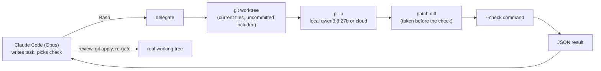

# Delegating to an executor

Claude Code with Opus stays the orchestrator. For a task that is mechanical and checkable by a command, it
hands the work to a cheaper executor: [pi](https://www.npmjs.com/package/@earendil-works/pi-coding-agent)
running a local Ollama model or a cloud model. The executor works in a throwaway git worktree. Opus gets back
one JSON object and judges the patch and the result of a check command it chose itself, never the executor's
own report. Sources: `claude/.claude/skills/delegate/` (`SKILL.md`, `scripts/delegate`,
`scripts/test-delegate`), and the `pi` package for the model definitions.

## Why this shape

Claude Code points one session at one endpoint, so a subagent cannot run on a different backend. A nested
headless process can, and it leaves the Opus session, its account and its subscription untouched. pi is the
executor rather than Claude Code itself or opencode because its system prompt plus tools is about 1,600
tokens, which matters on local hardware where every prompt token is prefill time. It also talks to the
OpenAI-compatible endpoint that every local server implements.



## Use

Ask for it: "delegate this to the local model", "let qwen do the boilerplate". The skill tells Claude when a
task qualifies (mechanical, checkable, bounded), how to write a self-contained task, and how to review the
result. By hand:

```bash
delegate --check 'python3 -m pytest tests/test_io.py -q' --link .venv \
  "Add type annotations to every function in src/io.py. Change nothing else."
```

| Option | Default | Purpose |
|---|---|---|
| `--model P/ID` | `$DELEGATE_MODEL`, else `ollama/qwen3.8:27b` | pi provider/model |
| `--check CMD` | none | Run in the worktree after the executor; `$DELEGATE_REPO` points at the real repo |
| `--timeout S` / `--check-timeout S` | 900 / 900 | Wall-clock limits; the executor's process group is killed |
| `--base REV` | `worktree` | Start from the current files (uncommitted and untracked included) or a revision |
| `--link PATH` | none | Symlink an ignored input (venv, fetched deps) into the worktree, kept out of the diff |
| `--tools LIST` | pi's defaults | pi tool allowlist |
| `--thinking LEVEL` | `low` | pi thinking level |
| `--keep-alive DUR` | `30m` | How long Ollama keeps the model loaded after the run |
| `--keep` | off | Keep the worktree for inspection |

Status values: `ok`, `check_failed`, `timeout`, `error`, `backend_down`. Exit status is 0 only for `ok`, and 2
for setup errors (not a git repository, pi missing). Artifacts stay in `$XDG_CACHE_HOME/delegate/<id>/`.

## Guarantees and limits

- **The real checkout never moves.** Snapshots use a private `GIT_INDEX_FILE`. The base commit is a dangling
  `commit-tree --no-gpg-sign` object. The worktree is created with hooks disabled and removed afterwards, even
  on timeout. `test-delegate` asserts this in every case.
- **The patch is what the executor changed**, compared against the starting tree, and taken before the check
  runs. Executor-created files show up as `A` lines and are part of the review. Python bytecode is suppressed
  (`PYTHONDONTWRITEBYTECODE=1`).
- **It is not a sandbox.** pi's `bash` can write outside the worktree. The worktree protects the repository,
  not `$HOME`.
- **A cloud model sends the files it reads to its provider.** Use one only on repositories where that is
  acceptable.

## Models

Defined in `pi/.pi/agent/models.json` (adam only, through `machines/adam`). Only that file is tracked: pi
rewrites `settings.json`, and `auth.json` holds keys.

| Model | Measured on adam (2 × RTX 4070) |
|---|---|
| `ollama/qwen3.8:27b` (Q4_K_M, 19 GB loaded, 32k context) | One-line bug fix with a check: 22 s warm; first load about 100 s, about 20% of the layers on the CPU |

`contextWindow` must match the context Ollama actually allocates (`ollama ps`, column CONTEXT). Ollama truncates
silently, so a larger value makes pi overrun a window it cannot see.

## Testing

```bash
~/.claude/skills/delegate/scripts/test-delegate --offline   # 18 cases, fake pi, no model
~/.claude/skills/delegate/scripts/test-delegate             # + a live fix with the local model
```

The offline cases swap pi for a fake through `DELEGATE_PI` and cover usage errors, a missing repository, a dead
backend, a dirty tree, a failing check, a timeout, an executor failure, `--link`, `--keep` and `--base`. The live
case needs Ollama and the model. `DELEGATE_TEST_MODEL` picks another one.
