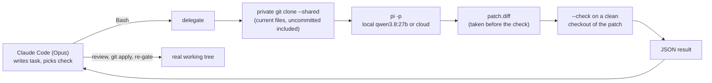

# Delegating to an executor

Claude Code with Opus stays the orchestrator. For a task that is mechanical and checkable by a command, it
hands the work to a cheaper executor: [pi](https://www.npmjs.com/package/@earendil-works/pi-coding-agent)
running a local Ollama model or a cloud model. The executor works in a throwaway git clone. Opus gets back
one JSON object and judges the patch and the result of a check command it chose itself, never the executor's
own report. Sources: `claude/.claude/skills/delegate/` (`SKILL.md`, `scripts/delegate`,
`scripts/test-delegate`), and the `pi` package for the model definitions.

## Why this shape

Claude Code points one session at one endpoint, so a subagent cannot run on a different backend. A nested
headless process can, and it leaves the Opus session, its account and its subscription untouched. pi is the
executor rather than Claude Code itself or opencode because its system prompt plus tools is about 1,600
tokens, which matters on local hardware where every prompt token is prefill time. It also talks to the
OpenAI-compatible endpoint that every local server implements.



## Use

Ask for it: "delegate this to the local model", "let qwen do the boilerplate". The skill tells Claude when a
task qualifies (mechanical, checkable, bounded), how to write a self-contained task, and how to review the
result. By hand:

```bash
delegate --check 'python3 -m pytest tests/test_io.py -q' --link .venv \
  "Add type annotations to every function in src/io.py. Change nothing else."
```

| Option | Default | Purpose |
|---|---|---|
| `--model P/ID` | `$DELEGATE_MODEL`, else `ollama/qwen3.8:27b` | pi provider/model |
| `--check CMD` | none | Run on a clean checkout of the patch tree plus `--link` paths; `$DELEGATE_REPO` points at the real repo |
| `--timeout S` / `--check-timeout S` | 900 / 900 | Wall-clock limits; the executor's process group is killed |
| `--base REV` | `worktree` | Start from the current files (uncommitted and untracked included) or a revision |
| `--link PATH` | none | Symlink an ignored input (venv, fetched deps) into the clone, never part of the patch |
| `--tools LIST` | pi's defaults | pi tool allowlist |
| `--thinking LEVEL` | `low` | pi thinking level |
| `--keep-alive DUR` | `30m` | How long Ollama keeps the model loaded after the run |
| `--keep` | off | Keep the clone for inspection (`workdir` in the result) |

Status values: `ok`, `check_failed`, `timeout`, `error`, `backend_down`, `interrupted`. Exit status is 0 only
for `ok`; 2 for setup errors found before the executor starts (not a git repository, pi missing, bad `--base`,
`--link` or `--out`); 128+N after signal N. Artifacts stay in `$XDG_CACHE_HOME/delegate/<id>/`. Apply a patch
with the `apply` field (`git -C <repo> apply <patch>`): a bare `git apply` from a subdirectory exits 0 and
skips every file outside it.

## Guarantees and limits

- **The caller's repository never moves.** Snapshots use a private `GIT_INDEX_FILE`. The base commit is a
  dangling `commit-tree --no-gpg-sign` object. The executor works in a `git clone --shared` with its remote
  removed and hooks disabled, so its commits, branches and stash stay there; a worktree would share refs with
  the caller. The clone is deleted afterwards, also on timeout and on SIGINT/SIGTERM/SIGHUP.
- **No executor process survives the run.** delegate is a child subreaper and kills every descendant after the
  executor and after the check: pi's `bash` tool detaches its children into their own process groups.
- **The patch is what the executor changed**, from plumbing (`git diff-tree --binary --full-index --no-textconv`
  …) written as raw bytes, so no diff configuration can alter it. Executor-created files show up as `A` lines
  and are part of the review. Python bytecode is suppressed (`PYTHONDONTWRITEBYTECODE=1`).
- **The check proves the patch**: it runs on a clean checkout of the patch tree plus `--link` paths, so an
  ignored file the executor left behind cannot make it pass.
- **It is not a sandbox.** pi's `bash` can write anywhere in `$HOME`. The clone protects the repository only.
- **Limits.** Submodules are empty in the clone. The starting snapshot writes blobs for untracked,
  non-ignored files into the caller's object store (unreachable, reclaimed by `git gc`).
- **A cloud model sends the files it reads to its provider.** Use one only on repositories where that is
  acceptable.

## Models

Defined in `pi/.pi/agent/models.json` (adam only, through `machines/adam`). Only that file is tracked: pi
rewrites `settings.json`, and `auth.json` holds keys.

| Model | Measured on adam (2 × RTX 4070) |
|---|---|
| `ollama/qwen3.8:27b` (Q4_K_M, 19 GB loaded, 32k context) | One-line bug fix with a check: 22 s warm; first load about 100 s, about 20% of the layers on the CPU |

`contextWindow` must match the context Ollama actually allocates (`ollama ps`, column CONTEXT). Ollama truncates
silently, so a larger value makes pi overrun a window it cannot see.

## Testing

```bash
~/.claude/skills/delegate/scripts/test-delegate --offline   # 36 checks, fake pi, no model
~/.claude/skills/delegate/scripts/test-delegate             # + a live fix with the local model
```

The offline cases swap pi for a fake through `DELEGATE_PI`. Besides the basics (usage, missing repository, dead
backend, dirty tree, failing check, timeout, executor failure, `--link`, `--keep`, `--base`) they hold one
reproducer per finding of the correctness review: binary and trailing-whitespace last hunks, hostile diff config,
a provider error behind exit 0, detached child processes, SIGTERM, executor commits/branches/stash, a sibling
worktree, the check on the patch tree, a task starting with `-`, Latin-1 content, malformed events, `--link
.venv/`, setup exit codes. The live case needs Ollama and the model. `DELEGATE_TEST_MODEL` picks another one.
