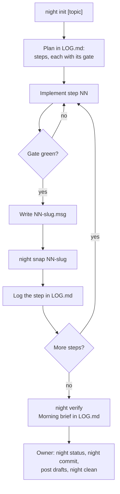

# Night protocol

The night protocol lets Claude work through a plan for hours while you are away, without waiting for review,
and without ever staging, committing, pushing or posting. Each green step is recorded as a git tree with a
patch, a file list and a commit message. In the morning you review the log and commit the whole chain with one
command, signed, from your own terminal. Sources: `claude/.claude/skills/night-protocol/` (`SKILL.md`,
`REFERENCE.md`, `scripts/night`).

## When to use it

Start it when you leave Claude with work that spans hours: say "night protocol", "/night-protocol", "I'll be
away for N hours", or "don't wait for my review, log everything for tomorrow". In the morning, say "drive me to
commit the night work".

Use it for a plan of separable steps, each with a gate (the commands that prove it green). It is not for
day-time work: a night and day-time staging or commits must not overlap (rule 7).

## One night



1. **Init.** `night init [topic]` at the repo root creates `.night/<date>[-topic]/`, points `.night/current` at it,
   records HEAD as the base and the changes already in the working tree as pre-existing. Claude then loads the
   repo's `CLAUDE.md` and any project memory about nights.
2. **Plan.** Ordered steps in `LOG.md`, each with its gate, sized to what the step touches. The full suite runs
   at the end, and per step only when a step changes shared code.
3. **Per step.** Implement, run the gate (never snapshot red), write `NN-slug.msg` (Conventional Commits, no AI
   trailer, gate evidence in the body), `night snap NN-slug`, append the step to the chronology with a time from
   `date`.
4. **Verify.** `night verify` must print `ok` for every step. Claude writes a *Morning brief* at the top of
   `LOG.md`: steps done, decisions left to you, what remains, anything flaky.
5. **Morning.** Your part, below.

Decisions while you are away: a reversible choice inside the agreed plan is taken and logged under *taken on the
owner's behalf*. Anything irreversible, outward-facing, or changing frozen behaviour, goldens or APIs is not done:
it is logged under *left to the owner* with evidence and options, and Claude moves to the next independent
step.

## Hard rules

| # | Rule |
|---|---|
| 1 | Never `git add`, `commit`, `stash`, `reset`, `checkout --`, `push`, nor touch the real index or branches |
| 2 | Never open, comment on, close or label issues and PRs, or send anything outward. Draft the text as `.night/current/<topic>.comment.md` |
| 3 | Never stop, never idle. Before ending a turn, arm an event source that fires on the first actionable result and a timed fallback at most 60 min ahead. Run long jobs where they survive the session; keep `LOG.md` current |
| 4 | On a rate limit, schedule a wakeup a few minutes after the reset, in the same turn, then resume every stopped agent |
| 5 | Never overwrite baselines or goldens in place: new results get new names |
| 6 | Killed or crashed is not stopped: resume, at lower parallelism if resources were the cause, without asking |
| 7 | No day-time git inside a night: close the night first, do the day work, then start a new night |

Project rules (repo `CLAUDE.md`, project memory) add to these; they never relax them.

## The morning

```bash
night status        # base, HEAD, steps, drafts, committed yes/no
night verify        # replay the chain
night commit --dry-run
night commit        # in your own terminal
```

1. Read the *Morning brief* in `.night/current/LOG.md`; ask Claude to summarise it, with `night status` and
   `night verify`.
2. Run `night commit` in **your own terminal**. It refuses without a TTY, so Claude cannot run it. It commits each
   step tree in order with its message, commit hooks and GPG signing included, and never touches the working
   tree. After a partial run it resumes from the step HEAD already holds.
3. Have the drafted comments posted (Claude can do it when you ask). Each posted draft is renamed
   `<topic>.comment.posted.md`. Drop night-only memories.
4. Run `night clean` in your terminal. It deletes the night directory once `night status` reports
   `committed: yes` and no draft is left to post.

`night` is on your PATH: `scripts/.scripts/night` is a relative symlink to the skill's script, which stow
deploys to `~/.scripts/night`. Claude calls the script by its absolute path in the skill, since an agent's shell
does not necessarily have `~/.scripts` on its PATH.

## Commands

Run from anywhere inside the repo; `night` changes to the top level. `NIGHT_DIR` overrides the active night
directory (default `.night/current`). `night` with no or an unknown subcommand prints the usage and exits 2.

| Command | Does |
|---|---|
| `night init [topic]` | Starts a night in `.night/<YYYY-MM-DD>[-topic]`. Refuses when the real index has staged changes or the directory exists. Writes `base`, an empty `chain`, `LOG.md` and `preexisting`; adds `/.night/` to `.git/info/exclude` |
| `night snap NN-slug [path...]` | Snapshots a step. The name must match `NN-slug` (two digits, lowercase); `NN-slug.msg` must exist. Without paths it records every change except unedited pre-existing ones. Refuses an empty step or an existing name. Prints the file list and warns when the real index has staged changes or HEAD moved |
| `night snap --redo NN-slug [path...]` | Replaces the snapshot of the **last** step only |
| `night gate [NN-slug] -- cmd [args]` | Checks out the tree of step `NN-slug`, or the tree `snap` would record now (label `candidate`), in a scratch worktree `wt-<label>`, runs `cmd` there with `NIGHT_REPO` (repo root) and `NIGHT_TREE` set, logs to `gate-<label>.log`, removes the worktree and returns the command's status |
| `night verify` | Replays every patch from the base on a scratch index and checks it reproduces its tree; prints `ok` or `FAIL` per step. Notes changes outside every step and a HEAD that moved off the base |
| `night status` | Night directory, base, HEAD, one line per step (files, subject), drafts to post and posted, `committed: yes/no` |
| `night commit [--dry-run]` | Owner only, needs a TTY. Verifies, refuses a staged index or a HEAD that is neither the base nor a step, then `git read-tree <tree>` and `git commit -F <msg>` per step. `--dry-run` prints those commands and runs without a TTY |
| `night clean [--all] [--force] [--dry-run]` | Owner only, needs a TTY unless `--dry-run`. Deletes the active night once committed and with no `*.comment.md` left. `--all` covers every night in `.night/`; `--force` skips both checks; `--dry-run` reports what it would remove. Exits 1 when it keeps a night. Removes `.night/` and its exclude line when nothing is left |

`committed` means the last step's tree is the tree of a commit in `base..HEAD`. A squash of the whole chain
counts; an amended last step or a rebase onto a moved upstream does not, and needs `--force`.

## Files in `.night/<night>/`

| File | Written by | Content |
|---|---|---|
| `base` | `init` | HEAD commit when the night started |
| `preexisting` | `init` | `blob-id<TAB>path` of each change already in the working tree (`-` = deleted) |
| `chain` | `snap` | One line per step: `NN-slug prev-tree step-tree` |
| `NN-slug.msg` | Claude | Commit message, required before `snap` |
| `NN-slug.tree` | `snap` | The step's tree object id |
| `NN-slug.patch` | `snap` | `git diff --binary prev step`, for review and `verify` |
| `NN-slug.files` | `snap` | `--name-status` of that diff |
| `LOG.md` | `init`, Claude | Morning brief, plan, decisions, chronology |
| `*.comment.md` | Claude | Drafted issue or PR text, not yet posted |
| `*.comment.posted.md` | Claude | The same draft once posted |
| `gate-<label>.log` | `gate` | Output of the last gate of that step, or of `candidate` |
| `wt-<label>/` | `gate` | Scratch worktree, removed when the gate ends |

`.night/` is in `.git/info/exclude`, local only: it never enters a snapshot or a commit.

## Why trees, not patches

A snapshot is a tree object built on a scratch index (`read-tree` of the previous step, `add -A`, `write-tree`),
so the real index, HEAD and branches never move during the night. The morning commit uses `git read-tree` of
each step tree, so each commit holds exactly the snapshot, hooks still run, and the working tree is not touched.
Patches serve review and `verify`. The script pins the git options your config would change
(`apply --whitespace=nowarn`, `diff.noprefix=false`, `--no-ext-diff`, `--no-textconv`), so the chain replays byte
for byte.

## Failure modes it closes

From the October and November 2026 nights (`REFERENCE.md` has the dated list):

| What went wrong | Now |
|---|---|
| Claude ended its turn waiting for jobs; nothing done by morning | Rule 3: no turn ends without a wake source |
| A watcher fired on the last of 14 runs, 3 h idle | Rule 3: event on the first result plus a timed fallback |
| A WSL reboot killed every in-session wake source, 14 h lost | Rule 3: long jobs outside the session, `LOG.md` current |
| Agents stalled hours on a rate limit | Rule 4: wakeup scheduled at the first notice |
| A job killed for memory and a harness notice stopped the agent | Rule 6: resume at lower parallelism |
| `git apply` of the morning patches failed on a working tree that already held them | `commit` uses `read-tree`, never applies patches to the real tree |
| Tarball snapshots silently reverted morning edits | Trees plus a verified patch chain |
| `apply.whitespace=fix` made `verify` fail on a correct chain | Git options pinned |
| Log times estimated, off by an hour | Times from `date` |
| A step needed a change to frozen behaviour | Stop the step, log evidence and options, move on |
| Hours of full suite to gate a two-line change | Gates sized per step, full suite at the end |
| Nights mixed with day-time staging; `commit` refused | Rule 7; `init` refuses a staged index; `snap` warns |
| A `HANDOFF-*.md` at risk of landing in step 01 | Pre-existing changes recorded and excluded |
| Posted drafts left around, nights cleaned by hand | `*.comment.posted.md` and `night clean` |

## Things to know

- `night commit` refuses when HEAD moved to a commit that is not a step: the step trees would revert it. Rebase
  by hand, applying the patches in order with `git apply --3way`.
- A bug found later in the last step is fixed with `snap --redo`. In an earlier step it becomes a new fix step;
  history is never rewritten.
- `night gate` runs on a clean checkout, without ignored files. Reach a venv, `node_modules` or fetched
  dependencies through `$NIGHT_REPO`. Each gate is a clean build, so use it for the step's real gate, not for
  edit-compile loops.
- `/semantic-commit` warns when a night is open; staging during a night makes `night commit` refuse until you
  unstage.
