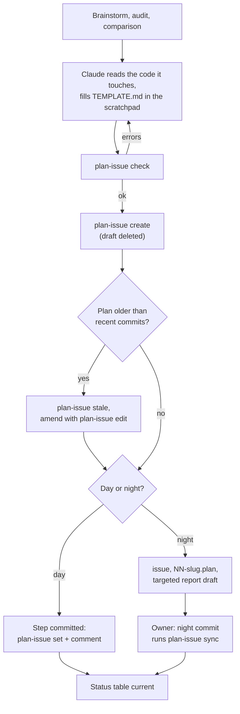

# Plan issues

A plan that comes out of a brainstorm, an audit or a feature discussion is filed as one GitHub issue, and that
issue is the plan's only copy. Its status table records progress. Each work session posts its log as a comment,
and the table row links to the log and to the commits. A script changes only that table, so a long body is never
regenerated to flip a row, and `night commit` brings the issue up to date as soon as the night's commits exist.
Sources: `claude/.claude/skills/plan-issue/` (`SKILL.md`, `TEMPLATE.md`, `COMPILER-BUGS.md`, `scripts/plan-issue`).

## When to use it

Ask for the plan as you always have: "create a well formatted GH issue with a step by step plan", "bullet proof
plan with test gates and docs in sync", "roadmap issue", "file the compiler bugs in a GH issue". Then "implement
#N in /night-protocol", "is the issue updated?", "check the status of the plan in #N".

It is for plans of separable steps that outlive one session. A one-off bug report needs no skeleton.

## One plan

1. **Write.** Claude reads the code the plan touches, so *Where the code stands* cites files and the base
   commit rather than memory. It fills the skeleton in the scratchpad, never in the repository.
2. **Lint.** `plan-issue check` until `ok`. Unresolved choices become `D` rows with a recommendation.
3. **File.** Claude shows you the step list unless you asked to post directly, then `plan-issue create` from the
   repository root opens the issue and the draft is deleted. A plan for another repository's change is filed
   there.
4. **Execute.** An old plan is revalidated first (`plan-issue stale`). In the day, each committed step gets its
   row set and its log posted. In a night, nothing is posted until `night commit`.

## The skeleton

`TEMPLATE.md`:

| Part | Content |
|---|---|
| Markers | `<!-- plan-issue v1 -->`, `<!-- plan-issue:base SHA -->` (the commit the plan was written against; `create` resolves `HEAD`) |
| Status | A table between `plan-issue:status:begin/end` markers: `Step \| Title \| Status \| Evidence`. Ids: `D<n>` decisions, `<phase>.<step>` steps, `G<n>` phase gates. Statuses ⬜ 🔄 ✅ ⏸ ➖ |
| 1. Goal | What exists when the plan is done, and the milestone it serves |
| 2. Where the code stands | The audit against the base commit, with file references |
| 3. Decisions | Each `D`: options, recommendation, outcome with date |
| 4. Standing gates | Build, tests, regression, performance, docs: a command and a pass criterion each |
| 5. Steps | Per step: **Goal**, **Changes**, **Gate**, **Docs**, **Commit**, **Depends on** |
| 6. Risks, 7. Out of scope | The latter with the reason and the issue that tracks it |

## Rules

| # | Rule |
|---|---|
| 1 | The issue is the only copy of the plan. Draft in the scratchpad, delete the draft once filed; no `PLAN.md` |
| 2 | Filing a plan is not implementing it. Code changes start only when you say so |
| 3 | Never regenerate a body to update it: status through `set` or `sync`, amendments through `body` → Edit → `edit` |
| 4 | Every gate can fail: commands plus a pass criterion with a number or an exact outcome. "Tests pass" is not a gate |
| 5 | Docs move with the code: each step names the pages and the figures or animations it produces, with the script that makes them |
| 6 | Bodies stay under 40,000 characters; long rationale goes to the repository docs |

## Commands

`REF` is `owner/repo#N`, `#N` (the repository of the current directory), an issue URL, or a local file path (the
body is then read and written in that file: offline drafts and tests). `plan-issue` with no subcommand prints
the usage and exits 2; errors exit 1.

| Command | Does |
|---|---|
| `plan-issue check FILE` | Lints a body. Errors: missing version marker, missing or malformed status block, duplicate ids, unknown status, unfilled `<...>` placeholders, a step id without a heading, an empty **Goal/Gate/Docs/Commit**, a `D` row without its `**D<n>**` entry, over 60,000 characters. Warnings: no base marker, no **Changes** (not for `G` rows), a gate with no backticked command, over 40,000 characters. Dropped (➖) steps skip the field checks |
| `plan-issue create REPO FILE --title T` | Replaces `plan-issue:base HEAD` with the current commit (run it from that repository), refuses on any lint error, opens the issue and prints its URL |
| `plan-issue body REF` | Prints the body, to amend it in a file |
| `plan-issue edit REF FILE [--force]` | Replaces the body. Refuses lint errors, removed status rows, removed or renamed headings, and done rows no longer done; `--force` overrides all but lint errors |
| `plan-issue status REF` | The rows (status, id, title, evidence) and the count per status |
| `plan-issue set REF ID STATUS [EVIDENCE]` | Changes one row. `STATUS` is `todo wip done blocked dropped` or the symbol; `EVIDENCE` replaces the cell |
| `plan-issue comment REF FILE` | Posts the file as a comment, prints its URL |
| `plan-issue stale REF` | From the base marker: the number of commits since, and the commits touching tracked paths the plan names in backticks |
| `plan-issue sync [--night-dir D] [--dry-run]` | Posts the night's targeted drafts and marks its committed steps, below. Default night: `.night/current` |

Every write to GitHub re-reads the issue's `updatedAt` first, and refuses if the issue changed after it was
read, so a box you ticked in the web UI is never overwritten.

## With the night protocol

During a night Claude writes, next to the steps:

| File | Content |
|---|---|
| `issue` | The plan issue's `REF`, one line |
| `NN-slug.plan` | The status ids that step completes, one per line; `<id> wip` when it only advances one; `#` comments allowed |
| `<topic>.comment.md` | The night report, first line `<!-- target: issue -->` (or `<!-- target: owner/repo#N -->`); <code v-pre>{{sha:NN-slug}}</code> stands for a step's commit SHA |

At the end of `night commit`, `plan-issue sync` runs by itself:

1. It maps each step to its commit through the step tree (`base..HEAD`), as `night clean` does.
2. It posts each draft that has a target line, with the placeholders replaced, and renames it
   `*.comment.posted.md`. A draft whose placeholders name an uncommitted step is skipped.
3. It sets the rows of each committed step to ✅ (or 🔄) with the short SHA and a link to the report it just posted.
4. It notes when the commits are not pushed: GitHub links the SHAs only after the push.

Drafts without a target line stay for posting by hand, as before. A failed sync never undoes the commits: rerun
`plan-issue sync` from the repository root. A second run changes nothing, since posted drafts are renamed and a
row that already holds the SHA is skipped.

## Compiler bugs

`COMPILER-BUGS.md` defines the other recurring issue: one tracker per repository, one comment per bug, indexed by
a table in the body. Each comment gives the toolchain with exact versions, how other compilers behave, the
standard rule the code conforms to (from the `fortran-2023-standard` skill), a self-contained reproducer with its
output, the expected output, the workaround with its location and how to tell it can go, and the vendor ticket.
The index is edited as a fixed-string change; `plan-issue edit` would refuse it, since it is not a plan.

## Why it exists

Between 9 October and 25 November 2026, about 35 plan issues were requested in 15 repositories, each time
restating the same requirements:

| What went wrong | Now |
|---|---|
| Five different status mechanisms across six issues; one issue had none | One skeleton, one status table, a lint |
| First drafts left out the performance gates and the docs, added after review | Standing gates and per-step **Docs** are required fields |
| Bodies updated by regenerating up to 45 KB, at risk of silently dropping sections | `set`/`sync` change only the table; `edit` refuses losses |
| The issue lagged the night (rule 2 forbids posting); "is the issue updated?" asked at least seven times | `night commit` runs `plan-issue sync` |
| Plan drafts kept in local files next to the issue | Rule 1: scratchpad only, deleted once filed |
| An old plan executed as written though the code had moved | `stale` before executing |
| Asked for an issue, got the code change | Rule 2 |

## Things to know

- Issues filed before this skill have no markers: `status`, `set` and `sync` refuse them. Migrate one when it is
  next touched (`body`, rewrite into the skeleton, `edit --force`, since headings change).
- `stale` sees only paths written in backticks that `git ls-files` knows; prose mentions are invisible to it.
- `plan-issue` is on your PATH: `scripts/.scripts/plan-issue` is a relative symlink to the skill's script, as for
  `night`. `night commit` finds it relative to its own location, so the two skills must stay siblings.
