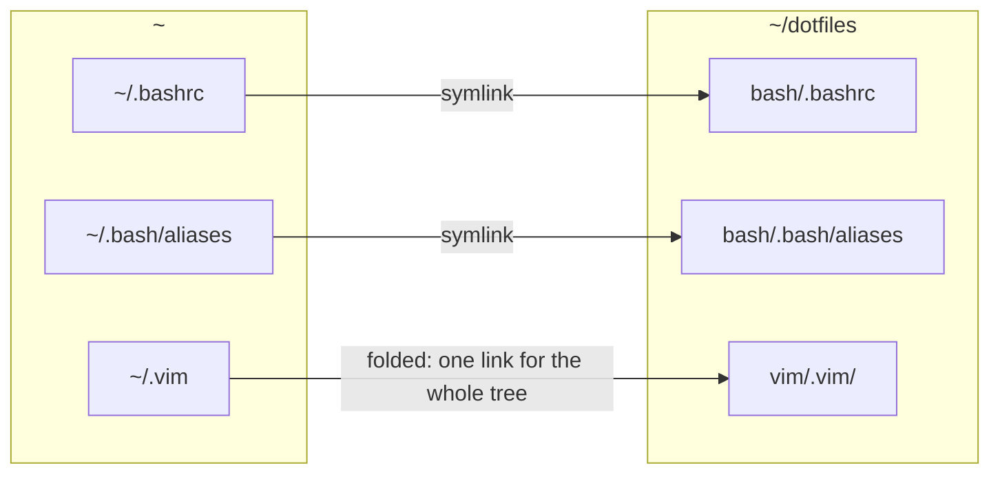

# Stow and dotify.sh

GNU Stow turns a directory that mirrors `$HOME` into symlinks under `$HOME`. `dotify.sh` is a thin
wrapper around it: the list of common packages, the machine profile, and one guard for the file Claude
Code keeps overwriting.

## How a package becomes links

A package is a directory whose inside has the shape of your home. `bash/.bashrc` becomes
`~/.bashrc → dotfiles/bash/.bashrc`; `bash/.bash/aliases` becomes `~/.bash/aliases`.



**Tree folding.** When the target directory does not exist, Stow links the directory itself rather
than its files: one link for `~/.vim`, none inside it. When a second package later needs the same
directory, Stow unfolds it into a real directory holding links. Folding is why some directories must be
created before the first deploy ([Fresh install, step 3](/guide/installation#_3-create-the-directories-that-must-stay-real)).

**Conflicts.** Stow never overwrites a real file. If one is in the way, it reports the conflict and
changes nothing; move the file and re-run.

## dotify.sh

```bash
bash ~/dotfiles/dotify.sh [OPTIONS] [packages...]
```

| Option | Effect |
|---|---|
| `-n`, `--dry-run` | show what would be done, change nothing |
| `-D`, `--uninstall` | remove the links of the packages |
| `-v`, `--verbose` | print every action |
| `-h`, `--help` | usage and the default package list |

Without package names it stows the common packages:

```text
bash vim nvim git claude modules python scripts miscellanea ssh tmux
```

With names, only those, in that order. **In both cases** it then reads `machines/$(hostname -s)` and
stows every package listed there ([The machines](/guide/machines)). It exits at once if `stow` is not
installed.

The links are made with `stow --dir=~/dotfiles --target=$HOME`, so they work wherever you run the
script from.

## Claude settings.json drift

Claude Code rewrites `~/.claude/settings.json` (on `/model`, on a plugin toggle, when an installer adds
a hook) by **replacing** the file. The link becomes a plain file and the next stow would abort. Before
stowing `claude`, `dotify.sh` checks it:

| Live `~/.claude/settings.json` | What dotify.sh does |
|---|---|
| a link, or absent | nothing |
| a plain file identical to the dotfile | removes it and re-links (`drift: … re-linking`) |
| a plain file that differs | prints the diff and the two ways out, then stops |

The two ways out, as printed:

```bash
# keep the live changes in the dotfile
cp ~/.claude/settings.json ~/dotfiles/claude/.claude/settings.json && rm ~/.claude/settings.json && bash ~/dotfiles/dotify.sh claude
# discard them
rm ~/.claude/settings.json && bash ~/dotfiles/dotify.sh claude
```

It never overwrites the dotfile on its own: the dotfile may hold uncommitted edits.

## What is not stowed

`dotify.sh` stows only the packages it is told about, so the other top-level entries are safe by
construction. Inside packages, `.stow-local-ignore` files keep non-$HOME content out of Stow's view:
`desktop/system/` and `desktop-astrobit/system/` hold root-owned files that their install scripts copy
under `/etc`.

## Things to know

- **A folded directory is the repository.** Writing into `~/.vim` writes into `vim/.vim/`: that is how
  vim-plug's plugins end up under the (gitignored) `vim/.vim/plugged/`.
- **`-L` is not enough to spot a link.** The drift check resolves the real path first: on a host where
  Stow folded all of `~/.claude`, the live file *is* the dotfile, and deleting it would delete it from
  the repository.
